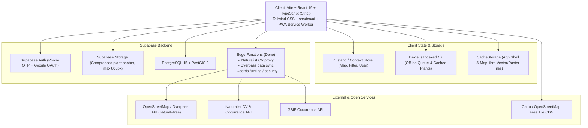
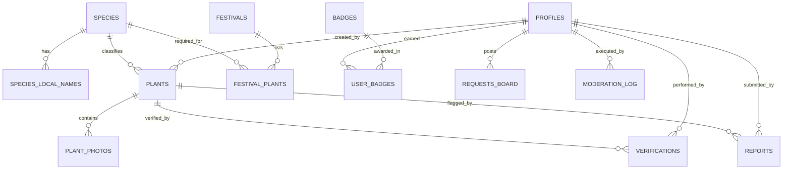

# PLAN.md - Master Architecture & Implementation Plan: Vriksha

**Project**: Vriksha (वृक्ष) - Free, Non-Profit, Community-Powered Map of Useful Trees & Plants Across India  
**Tagline**: "Google Maps for trees and plants" for everyday, medicinal, and festival needs  
**Author**: Ariavis
**Date**: October 2026  
**Status**: Approved - Active Execution  

---

## 1. Executive Summary & Vision

### 1.1 The Core Problem
Across India, hundreds of millions of people regularly need specific leaves, flowers, twigs, or fruits for daily pujas, major festivals, home remedies, and Ayurvedic wellness:
- **Festivals**: Bilva (bael) leaves & Dhatura for Maha Shivratri, Shami leaves for Dussehra, Mango leaves & Durva grass for Ganesh Chaturthi, Tulsi for Tulsi Vivah, Peepal leaves for Vat Savitri, Aak/Calotropis for Hanuman Jayanti.
- **Home & Medicinal Remedies**: Fresh Neem leaves for skin ailments and chickenpox relief, Tulsi for teas and coughs, Adhatoda (Vasaka) for breathing relief, Aloe Vera, Curry leaves (Kadi Patta).
- **Daily Utility**: Lemon grass, Hibiscus (Gudhal) for daily puja, drumstick/moringa leaves.

Urban and suburban residents often cannot find the nearest specimen, or discover that a previously known tree was felled, or arrive to find it out of season. Existing apps are either academic tree censuses or conservation tools focused on taxonomy and biodiversity metrics rather than **practical everyday utility: "Where is the nearest one, is it still there today, and is it currently bearing leaves/fruit?"**

### 1.2 Core Product Identity
- **Utility First**: Optimized for finding what you need right now within walking or short driving distance.
- **Freshness Engine**: Dynamic decay clock indicating whether a plant was recently confirmed or might be gone, backed by community one-tap verifications ("Still here" / "It's gone").
- **Festival & Puja Mode**: First-of-its-kind ritual helper showing checklists of required plants for 12+ Indian festivals, showing the closest locations, and calculating an optimized multi-stop collection route ("Plan my trip").
- **Safety, Ethics & Conservation Safe**: Strict PostGIS 5-km fuzzing for restricted/endangered species (e.g., Sandalwood, Red Sanders), harvesting etiquette banners, toxicity warnings, and private property consent gates.
- **True PWA**: Works offline in parks, villages, and areas with spotty connectivity with cached map sectors and an offline submission queue.

---

## 2. Architecture Overview



### 2.1 Technology Stack Justification
| Component | Choice | Justification |
| :--- | :--- | :--- |
| **Framework** | **Vite + React (TypeScript Strict)** | Instant HMR, minimal bundle overhead, robust typing prevents coordinate/null regressions. |
| **Styling & UI** | **Tailwind CSS + shadcn/ui + Lucide Icons** | Mobile-first, responsive, accessible ARIA components, warm earthy palette (forest green `#1B4D3E`, terracotta `#C85A32`, saffron `#E67E22`, warm cream `#FDFBF7`). |
| **Mapping Engine** | **MapLibre GL JS** | Open-source fork of Mapbox GL, hardware accelerated (WebGL), completely free with zero proprietary access tokens or billing requirements. |
| **Basemap Tiles** | **Carto Voyager / OpenStreetMap standard raster/vector** | 100% free open-access tier, no paid map keys required, high contrast in bright Indian sunlight. |
| **Clustering** | **Supercluster + MapLibre GeoJSON source** | Renders 10,000+ plant markers at 60 FPS smoothly on mobile hardware with dynamic radius aggregation. |
| **Backend & DB** | **Supabase (PostgreSQL + PostGIS)** | Native spatial indices (`GIST`), geography types, spatial functions (`ST_DWithin`, `ST_Distance`, `ST_SnapToGrid`), robust Row Level Security (RLS) on every table. |
| **Edge Functions** | **Supabase Edge Functions (Deno/TS)** | Low-latency serverless endpoints to proxy iNaturalist computer vision API and run Overpass queries without exposing external tokens or encountering CORS. |
| **Offline & PWA** | **vite-plugin-pwa + Dexie.js (IndexedDB)** | Offline app shell caching, background sync queue for plant submissions and verifications made while disconnected. |
| **Internationalization** | **react-i18next** | Multilingual search and UI: full English & Hindi; complete localized stubs for 9 major regional Indian languages. |
| **Testing** | **Vitest + Testing Library + Playwright + pgTAP** | Unit tests for freshness algorithms and image compression; Playwright for E2E critical flows; SQL tests for RLS & spatial privacy. |

---

## 3. Detailed Data Model (Postgres + PostGIS)

All schema objects are deployed through versioned migrations in `/supabase/migrations`. Every table has `ROW LEVEL SECURITY (RLS)` enabled.

### 3.1 Entity Relationship Diagram



### 3.2 Table Definitions

#### 1. `species` (Master Plant Taxonomy)
- `id` (UUID, PK, default `gen_random_uuid()`)
- `scientific_name` (TEXT, UNIQUE, NOT NULL) - e.g., "Azadirachta indica"
- `common_name_en` (TEXT, NOT NULL) - e.g., "Neem"
- `common_name_hi` (TEXT, NOT NULL) - e.g., "नीम"
- `plant_type` (TEXT, NOT NULL) - ENUM: `'large_tree'`, `'shrub'`, `'herb'`, `'grass'`
- `use_tags` (TEXT[], NOT NULL) - Array of tags: `['puja', 'medicinal', 'fruit', 'shade', 'flowers', 'leaves_decoration', 'edible']`
- `parts_used` (TEXT[], NOT NULL) - `['leaves', 'bark', 'fruit', 'flowers', 'twigs', 'roots', 'seeds']`
- `seasonality_flowering` (INTEGER[], NOT NULL) - Months active (1 to 12)
- `seasonality_fruiting` (INTEGER[], NOT NULL) - Months active (1 to 12)
- `seasonality_fresh_leaves` (INTEGER[], NOT NULL) - Months active (1 to 12)
- `is_toxic` (BOOLEAN, default `false`)
- `toxicity_details` (TEXT, nullable) - E.g. "Seeds and milky sap are highly toxic if ingested"
- `is_restricted` (BOOLEAN, default `false`) - E.g. Sandalwood (*Santalum album*), Red Sanders
- `conservation_status` (TEXT, default `'least_concern'`)
- `harvesting_etiquette` (TEXT, nullable) - Specific guidance for this species
- `needs_review` (BOOLEAN, default `false`) - Set if seeded fact requires botanical verification
- `created_at` (TIMESTAMPTZ, default `now()`)

#### 2. `species_local_names` (Multilingual Regional Synonym Registry)
- `id` (UUID, PK)
- `species_id` (UUID, FK -> `species.id` ON DELETE CASCADE)
- `language_code` (TEXT, NOT NULL) - ISO code (`'hi'`, `'sa'`, `'bn'`, `'ta'`, `'te'`, `'mr'`, `'gu'`, `'kn'`, `'ml'`, `'pa'`, `'or'`)
- `local_name` (TEXT, NOT NULL) - e.g., "വേപ്പ്" (Malayalam), "வேம்பு" (Tamil), "వేప" (Telugu), "নিম" (Bengali)
- `transliteration` (TEXT) - Latin script pronunciation
- `region_notes` (TEXT)
- UNIQUE (`species_id`, `language_code`, `local_name`)

#### 3. `plants` (Physical Plant Instances On Ground)
- `id` (UUID, PK)
- `species_id` (UUID, FK -> `species.id`, NOT NULL)
- `location` (GEOGRAPHY(Point, 4326), NOT NULL) - PostGIS exact spatial point
- `fuzzed_location` (GEOGRAPHY(Point, 4326), NOT NULL) - ~5 km fuzzed grid centroid (computed via trigger/RPC)
- `address_hint` (TEXT) - e.g., "Opposite Shiva Temple, Sector 4 Park"
- `land_type` (TEXT, NOT NULL) - ENUM: `'public'`, `'temple'`, `'institution'`, `'private'`
- `private_owner_consent` (BOOLEAN, default `false`, CHECK: if `land_type = 'private'`, must be `true`)
- `notes` (TEXT)
- `source` (TEXT, NOT NULL, default `'community'`) - ENUM: `'community'`, `'osm'`, `'inaturalist'`, `'gbif'`, `'falling_fruit'`
- `source_id` (TEXT) - Original ID in Overpass or iNaturalist
- `source_url` (TEXT)
- `license` (TEXT, NOT NULL, default `'CC BY-SA 4.0'`)
- `attribution` (TEXT, NOT NULL, default `'Community contributor'`)
- `imported_at` (TIMESTAMPTZ, nullable)
- `last_verified_at` (TIMESTAMPTZ, NOT NULL, default `now()`)
- `verification_count` (INTEGER, default `1`)
- `gone_report_count` (INTEGER, default `0`)
- `status` (TEXT, NOT NULL, default `'recently_verified'`) - ENUM: `'recently_verified'`, `'needs_recheck'`, `'possibly_gone'`, `'reported_gone'`
- `is_sacred_heritage` (BOOLEAN, default `false`)
- `heritage_story` (TEXT, nullable)
- `created_by` (UUID, FK -> `profiles.id`, nullable for imported)
- `created_at` (TIMESTAMPTZ, default `now()`)
- `updated_at` (TIMESTAMPTZ, default `now()`)

#### 4. `plant_photos` (Photo Timeline)
- `id` (UUID, PK)
- `plant_id` (UUID, FK -> `plants.id` ON DELETE CASCADE)
- `photo_url` (TEXT, NOT NULL)
- `thumbnail_url` (TEXT, NOT NULL)
- `caption` (TEXT)
- `taken_at` (TIMESTAMPTZ, default `now()`)
- `uploaded_by` (UUID, FK -> `profiles.id`)
- `license` (TEXT, default `'CC BY-SA 4.0'`)
- `attribution` (TEXT, NOT NULL)
- `is_primary` (BOOLEAN, default `false`)
- `created_at` (TIMESTAMPTZ, default `now()`)

#### 5. `verifications` (Ground-Truth Verification Log)
- `id` (UUID, PK)
- `plant_id` (UUID, FK -> `plants.id` ON DELETE CASCADE)
- `user_id` (UUID, FK -> `profiles.id`, NOT NULL)
- `verification_type` (TEXT, NOT NULL) - ENUM: `'still_here'`, `'photo_added'`, `'details_updated'`
- `user_lat` (DOUBLE PRECISION, nullable) - Proximity verification check
- `user_lng` (DOUBLE PRECISION, nullable)
- `created_at` (TIMESTAMPTZ, default `now()`)

#### 6. `reports` (Community Moderation & Gone Flagging)
- `id` (UUID, PK)
- `plant_id` (UUID, FK -> `plants.id` ON DELETE CASCADE)
- `user_id` (UUID, FK -> `profiles.id`, NOT NULL)
- `report_type` (TEXT, NOT NULL) - ENUM: `'gone'`, `'wrong_species'`, `'private_property_violation'`, `'inappropriate_photo'`, `'spam'`
- `details` (TEXT)
- `is_resolved` (BOOLEAN, default `false`)
- `resolved_by` (UUID, FK -> `profiles.id`, nullable)
- `created_at` (TIMESTAMPTZ, default `now()`)

#### 7. `festivals` (Occasions and Ritual Calendars)
- `id` (UUID, PK)
- `slug` (TEXT, UNIQUE, NOT NULL) - e.g. `'maha-shivratri'`, `'dussehra'`, `'tulsi-vivah'`
- `name_en` (TEXT, NOT NULL)
- `name_hi` (TEXT, NOT NULL)
- `description_en` (TEXT)
- `description_hi` (TEXT)
- `typical_month` (INTEGER) - 1 to 12
- `lunar_tithi_desc` (TEXT) - e.g., "Phalguna Krishna Chaturdashi"
- `next_observed_date` (DATE, NOT NULL)
- `region` (TEXT, default `'All India'`)
- `needs_local_review` (BOOLEAN, default `true`)
- `created_at` (TIMESTAMPTZ, default `now()`)

#### 8. `festival_plants` (Checklist per Festival)
- `id` (UUID, PK)
- `festival_id` (UUID, FK -> `festivals.id` ON DELETE CASCADE)
- `species_id` (UUID, FK -> `species.id` ON DELETE CASCADE)
- `purpose` (TEXT, NOT NULL) - e.g. "Offering to Lord Shiva (Trifoliate leaves)"
- `part_needed` (TEXT, NOT NULL) - e.g. "Fresh leaves (Belpatra)", "Dhatura fruit", "Flowers"
- `alternative_species_ids` (UUID[]) - Optional substitutes if unavailable
- `is_essential` (BOOLEAN, default `true`)
- `needs_local_review` (BOOLEAN, default `true`)

#### 9. `profiles` & `badges`
- `profiles`: `id` (UUID, references `auth.users`), `username`, `display_name`, `avatar_url`, `role` (`'user'`, `'moderator'`, `'admin'`), `points` (INTEGER, default 0), `created_at`.
- `badges`: `id`, `slug`, `title`, `description`, `icon_name`, `points_required`.
- `user_badges`: `id`, `user_id`, `badge_id`, `awarded_at`.

#### 10. `requests_board` ("Need it / Have it" Community Exchange)
- `id` (UUID, PK)
- `user_id` (UUID, FK -> `profiles.id`)
- `request_type` (TEXT, NOT NULL) - `'need_it'` or `'have_it'`
- `species_id` (UUID, FK -> `species.id`)
- `custom_title` (TEXT, NOT NULL)
- `description` (TEXT)
- `fuzzed_location` (GEOGRAPHY(Point, 4326), NOT NULL) - Strictly approximate (~2-5km)
- `locality_name` (TEXT, NOT NULL) - e.g., "Indiranagar, Bengaluru"
- `contact_preference` (TEXT) - e.g., "In-app message"
- `status` (TEXT, default `'active'`)
- `expires_at` (TIMESTAMPTZ)
- `created_at` (TIMESTAMPTZ, default `now()`)

#### 11. `nurseries` (Nurseries and Free-Sapling Distribution Points)
- `id` (UUID, PK)
- `name` (TEXT, NOT NULL)
- `location` (GEOGRAPHY(Point, 4326), NOT NULL)
- `nursery_type` (TEXT, NOT NULL) - `'commercial'`, `'free_sapling_point'`, `'forest_dept'`, `'ngo'`
- `contact_number` (TEXT)
- `available_species_notes` (TEXT)
- `verified` (BOOLEAN, default `false`)
- `created_at` (TIMESTAMPTZ, default `now()`)

#### 12. `moderation_log`
- `id` (UUID, PK), `moderator_id`, `action`, `target_type`, `target_id`, `reason`, `previous_state`, `new_state`, `created_at`.

---

### 3.3 Core Spatial RPC: `nearest_plants`

The Postgres RPC `nearest_plants` is the central spatial query for map discovery, search, and festival route planning. It contains **built-in spatial security** for restricted species:

```sql
CREATE OR REPLACE FUNCTION nearest_plants(
  p_lat DOUBLE PRECISION,
  p_lng DOUBLE PRECISION,
  p_radius_meters DOUBLE PRECISION DEFAULT 10000,
  p_species_id UUID DEFAULT NULL,
  p_query TEXT DEFAULT NULL,
  p_use_tags TEXT[] DEFAULT NULL,
  p_freshness_statuses TEXT[] DEFAULT NULL,
  p_limit INTEGER DEFAULT 50
)
RETURNS TABLE (
  id UUID,
  species_id UUID,
  scientific_name TEXT,
  common_name_en TEXT,
  common_name_hi TEXT,
  plant_type TEXT,
  use_tags TEXT[],
  lat DOUBLE PRECISION,
  lng DOUBLE PRECISION,
  distance_meters DOUBLE PRECISION,
  land_type TEXT,
  status TEXT,
  last_verified_at TIMESTAMPTZ,
  is_restricted BOOLEAN,
  primary_photo_url TEXT,
  source TEXT,
  attribution TEXT
)
LANGUAGE plpgsql
SECURITY DEFINER
AS $$
DECLARE
  v_is_moderator BOOLEAN;
  v_user_pt GEOGRAPHY;
BEGIN
  -- Check caller's role from JWT claims
  v_is_moderator := EXISTS (
    SELECT 1 FROM profiles 
    WHERE id = auth.uid() AND role IN ('moderator', 'admin')
  );
  v_user_pt := ST_SetSRID(ST_MakePoint(p_lng, p_lat), 4326)::geography;

  RETURN QUERY
  SELECT
    p.id,
    p.species_id,
    s.scientific_name,
    s.common_name_en,
    s.common_name_hi,
    s.plant_type,
    s.use_tags,
    -- CRITICAL PRIVACY: If restricted species and not moderator, return fuzzed coordinates
    CASE 
      WHEN s.is_restricted AND NOT v_is_moderator THEN ST_Y(p.fuzzed_location::geometry)
      ELSE ST_Y(p.location::geometry)
    END AS lat,
    CASE 
      WHEN s.is_restricted AND NOT v_is_moderator THEN ST_X(p.fuzzed_location::geometry)
      ELSE ST_X(p.location::geometry)
    END AS lng,
    ST_Distance(p.location, v_user_pt) AS distance_meters,
    p.land_type,
    p.status,
    p.last_verified_at,
    s.is_restricted,
    (SELECT photo_url FROM plant_photos ph WHERE ph.plant_id = p.id AND ph.is_primary LIMIT 1) AS primary_photo_url,
    p.source,
    p.attribution
  FROM plants p
  JOIN species s ON s.id = p.species_id
  WHERE 
    p.status != 'reported_gone'
    AND ST_DWithin(p.location, v_user_pt, p_radius_meters)
    AND (p_species_id IS NULL OR p.species_id = p_species_id)
    AND (p_freshness_statuses IS NULL OR p.status = ANY(p_freshness_statuses))
    AND (p_use_tags IS NULL OR s.use_tags && p_use_tags)
    AND (p_query IS NULL OR (
      s.common_name_en ILIKE '%' || p_query || '%'
      OR s.common_name_hi ILIKE '%' || p_query || '%'
      OR s.scientific_name ILIKE '%' || p_query || '%'
      OR EXISTS (
        SELECT 1 FROM species_local_names sln 
        WHERE sln.species_id = s.id AND sln.local_name ILIKE '%' || p_query || '%'
      )
    ))
  ORDER BY distance_meters ASC
  LIMIT p_limit;
END;
$$;
```

---

## 4. Freshness System (Single Source of Truth)

### 4.1 Decay Rules & Status Transition Table
| Plant Type | `recently_verified` | `needs_recheck` | `possibly_gone` | Trigger for `reported_gone` |
| :--- | :--- | :--- | :--- | :--- |
| **Large Tree** | 0 to 18 months | 18 to 36 months | > 36 months | 2 independent gone reports |
| **Shrub** | 0 to 6 months | 6 to 12 months | > 12 months | 2 independent gone reports |
| **Herb / Small Plant** | 0 to 2 months | 2 to 4 months | > 4 months | 2 independent gone reports |

### 4.2 Single Source of Truth Implementation
- Client: `src/config/freshness.ts` export `FRESHNESS_CONFIG` and `computeFreshnessStatus(lastVerifiedAt, plantType, goneCount)`.
- Server: PostgreSQL SQL function `calculate_plant_freshness(last_verified_at TIMESTAMPTZ, plant_type TEXT, gone_count INT) RETURNS TEXT`.
- An automated SQL trigger on `verifications` and `reports` recalculates `plants.status` instantly upon any interaction.
- If a single user clicks "Still Here", `last_verified_at` is set to `now()`, `gone_report_count` is reset, and status immediately returns to `recently_verified`.
- If 2 distinct users file a report of type `gone`, `plants.status` becomes `reported_gone` and is excluded from map and search results.

### 4.3 Proximity Recheck Prompt
- If an active user has granted geolocation permission and comes within **100 meters** of a plant flagged as `needs_recheck`:
  - A gentle, non-intrusive toast/card appears: *"You're near a [Neem] tree. Is it still here?"* with quick buttons: `[Yes, Still Here]` / `[No, Gone]` / `[Dismiss]`.
  - Rate-limited to max **once per plant per day** tracked in client `localStorage` (`vriksha_prompted_plants_${plantId}`).

---

## 5. Security, Ethics, and Privacy Protections

### 5.1 Restricted Species Shield
1. **Database Level**:
   - `plants.fuzzed_location` is calculated automatically on insert/update using `ST_SnapToGrid(location::geometry, 0.05)::geography` (~5 km grid fuzzing).
   - `plants` public table RLS prevents anonymous and regular users from reading the raw `location` column for rows where `species.is_restricted = true`.
   - The `nearest_plants` RPC explicitly returns `fuzzed_location` whenever `is_restricted = true` unless the caller has `role IN ('moderator', 'admin')`.
2. **API & Export Level**:
   - Open data exports (GeoJSON/CSV) run through a sanitizer that excludes restricted species entirely or exports only their fuzzed centroid with an explicit disclaimer.

### 5.2 Harvesting Etiquette & Safety
- **Every plant view** renders a persistent, warm etiquette badge:  
  *"🌿 Harvesting Etiquette: Take only a few leaves or fallen twigs. Never strip bark, branches, or roots. Always ask permission on temple, institutional, or private grounds."*
- **Toxicity Warnings**: For dangerous plants (e.g. Dhatura, Calotropis/Aak, Kaner/Oleander, Castor/Arandi), high-contrast amber/red warning banners state:  
  *"⚠️ TOXIC PLANT: Highly poisonous if ingested or in contact with eyes. Keep away from children and pets. Traditional external or ritual use only."*
- **Medical Disclaimer**:  
  *"ℹ️ Traditional use only. Not medical advice. Consult a certified Ayurvedic or medical practitioner before consuming any plant."*
- **Private Property Consent**: Adding a plant on private land has a required, disabled-by-default checkbox: *"I confirm the landowner has agreed to share this plant's location with the community."*

### 5.3 Contributor Privacy
- Contributor home locations are never collected.
- Contributor profiles display a chosen display name or pseudonym (e.g. "DelhiFloraScout").
- Verification history logs display timestamp and username only.

---

## 6. Festival & Puja Mode Specification

### 6.1 Seeded Occasions (12 Festivals)
1. **Maha Shivratri** (Bael / Bilva patra, Dhatura fruit & flower, Bhaang / Cannabis, Shami leaves, White Kaner, Aak flowers).
2. **Dussehra / Vijayadashami** (Shami / *Prosopis cineraria* or *Vachellia*, Apta leaves /*Bauhinia racemosa*, Marigold flowers).
3. **Diwali & Dhanteras** (Mango leaves for Toran, Ashoka leaves, Marigold / Genda, Tulsi leaves).
4. **Chhath Puja** (Sugarcane stalks with leaves, Banana plant / Patta, Ginger / Adrak plant, Turmeric / Haldi plant, Daubh / Grapefruit).
5. **Tulsi Vivah** (Tulsi / Holy Basil, Sugarcane, Amla / Indian Gooseberry branches, Tamarind).
6. **Ganesh Chaturthi** (21 Patrika checklist: Durva grass, Bael, Shami, Dhatura, Kaner, Hibiscus / Gudhal, Arjuna, Tulsi (only for Ganesh Chaturthi per tradition), etc.).
7. **Vat Savitri** (Vat / Banyan tree / *Ficus benghalensis* leaves & bark, Peepal).
8. **Ugadi / Gudi Padwa** (Neem leaves and flowers for Ugadi Pachadi, Mango leaves).
9. **Navratri & Durga Puja** (Navapatrika / 9 sacred plants: Banana, Turmeric, Bael, Pomegranate, Ashoka, Jayanti, Colocasia, Manaka, Rice plant).
10. **Makar Sankranti / Pongal** (Fresh turmeric plant with root & leaves, Sugarcane, Banana leaves).
11. **Raksha Bandhan / Shravani Purnima** (Durva grass, Tulsi, Akshata).
12. **Guru Purnima / Buddha Purnima** (Peepal tree / *Ficus religiosa*, Banyan tree).

### 6.2 "Plan My Trip" Optimization Algorithm
When a user selects a festival checklist:
1. For each item in the checklist, fetch the nearest 3 available instances using `nearest_plants`.
2. A client-side Greedy Nearest Neighbor / TSP Solver takes the user's current GPS coordinate and computes an optimal visiting sequence that covers all checklist items with minimum travel distance.
3. Provides one-tap "Open in Google Maps" multi-stop route deep link.
4. Shows a prominent note: *"Ritual practices and plant requirements vary by region, tradition, and family. Moderated community edits are welcomed."* Every seeded list is marked with `needs_local_review = true`.

---

## 7. Data Ingestion & Seeding Pipeline

### 7.1 Data Sources & Policy Registry (`DATA_SOURCES.md`)
- **OpenStreetMap (Overpass API)**:
  - Query: `node["natural"="tree"]["species"](around:radius,lat,lng)` and `node["natural"="tree"]["taxon"]`.
  - Fetch on-demand for viewed bounding boxes, cached in Postgres & IndexedDB.
  - Attribution: *"© OpenStreetMap contributors, ODbL"*.
- **iNaturalist API**:
  - Research-grade occurrences in India for curated ~80 useful species.
  - License filtering: Only import observations licensed CC0, CC BY, or CC BY-NC.
  - Keep observation URL, observer username, and photo credit. Respect obscured coordinates.
  - Attribution: *"Observation by [observer] via iNaturalist, [license]"*.
- **GBIF (Global Biodiversity Information Facility)**:
  - Secondary verification source using GBIF Occurrence API with CC BY licensing.
- **India Biodiversity Portal & eFloraofIndia**:
  - Referenced for authoritative nomenclature, local vernacular names, and botanical descriptions only. Direct deep link out with full attribution. Never scraped or wholesale replicated.
- **Falling Fruit**:
  - Verified open license (CC BY-NC-SA or CC BY). Registered in `DATA_SOURCES.md` before ingest.

### 7.2 Initial Species Seed (~80 Species)
Seeded with:
- Sacred/Puja: Neem, Bael, Tulsi (Shyam & Rama), Shami, Peepal, Banyan, Dhatura, Kaner, Aak/Calotropis, Durva, Mango, Ashoka, Parijat/Harsingar, Lotus, Marigold, Hibiscus, Banana.
- Medicinal & Home Remedies: Amla, Vasaka (Adhatoda), Giloy (Guduchi), Moringa/Sahjan, Kadi Patta (Curry tree), Aloe Vera, Ashwagandha, Brahmi, Tulsi, Shatavari, Bhringraj, Haritaki, Baheda, Jamun, Guava, Pomegranate, Lemon/Nimbu.
- Any uncertain attribute is flagged with `needs_review: true`.
- Demo data flag `SEED_DEMO=true` generates realistic demo clusters around **Patna, Varanasi, Delhi, and Bengaluru**.

---

## 8. Repository Folder Structure

```text
c:\Users\Swapnil\OneDrive\Desktop\Programming\Vriksha
├── .github/
│   └── workflows/
│       └── ci.yml                 # Lint, Typecheck, Unit Tests, Build check
├── public/
│   ├── favicon.ico
│   ├── pwa-192x192.png
│   ├── pwa-512x512.png
│   └── robots.txt
├── scripts/
│   ├── seed-species.ts            # Master ~80 species taxonomy seed
│   ├── seed-festivals.ts          # 12+ festivals & checklists
│   ├── seed-demo-plants.ts        # Realistic clusters (Patna, Varanasi, Delhi, Bengaluru)
│   ├── import-osm-overpass.ts     # CLI Overpass ingest tool
│   └── import-inaturalist.ts      # CLI iNaturalist research-grade ingest tool
├── src/
│   ├── assets/                    # SVG icons, botanical leaf accents, fallback graphics
│   ├── components/
│   │   ├── common/
│   │   │   ├── DisclaimerBanner.tsx   # Harvesting etiquette & medical disclaimers
│   │   │   ├── Header.tsx             # Navbar, language switcher, auth modal trigger
│   │   │   ├── OfflineBadge.tsx       # Offline indicator & sync status
│   │   │   └── ToxicityAlert.tsx      # Prominent warning for poisonous species
│   │   ├── festival/
│   │   │   ├── FestivalCalendar.tsx   # Upcoming festival list & cards
│   │   │   ├── FestivalChecklist.tsx  # Interactive plant checklist
│   │   │   └── TripPlannerModal.tsx   # Multi-stop collection route optimizer
│   │   ├── forms/
│   │   │   ├── AddPlantModal.tsx      # Add plant wizard (Photo + GPS + Species)
│   │   │   ├── ImageCompressor.tsx    # Client canvas compressor (max ~800px)
│   │   │   ├── SpeciesPicker.tsx      # Searchable species selector with "Not sure"
│   │   │   └── LocationAdjuster.tsx   # Map pin fine-tuning
│   │   ├── map/
│   │   │   ├── MapContainer.tsx       # MapLibre GL instance, geolocation, controls
│   │   │   ├── MapClusterLayer.tsx    # Supercluster integration & colored pins
│   │   │   ├── FilterChips.tsx        # Puja, Medicinal, Fruit, In Season, Verified
│   │   │   └── NearestBottomSheet.tsx # Mobile swipeable list of nearby plants
│   │   ├── moderation/
│   │   │   ├── ModerationDashboard.tsx
│   │   │   ├── ReportQueue.tsx
│   │   │   └── DuplicateMergeTool.tsx
│   │   ├── plant/
│   │   │   ├── FreshnessBadge.tsx     # Colored freshness status badge
│   │   │   ├── PlantCard.tsx          # Compact list item
│   │   │   ├── PlantDetailSheet.tsx   # Full details, timeline, actions, etiquette
│   │   │   ├── SeasonalityStrip.tsx   # 12-month flowering/fruiting/leaf strip
│   │   │   └── VerificationLog.tsx    # Chronological confirmation log
│   │   └── ui/                        # Reusable shadcn/ui primitives (Button, Dialog, etc.)
│   ├── config/
│   │   ├── freshness.ts               # Decay thresholds, status computation logic
│   │   ├── map.ts                     # Tile endpoints, initial bounds, max bounds
│   │   └── constants.ts               # Storage buckets, tag colors, app metadata
│   ├── hooks/
│   │   ├── useGeolocation.ts          # Browser GPS tracking & watchPosition
│   │   ├── useOfflineQueue.ts         # Dexie sync manager for submissions/verifications
│   │   ├── useFreshnessPrompt.ts      # 100m proximity detector for recheck prompt
│   │   └── useVoiceSearch.ts          # Web Speech API speech recognition hook
│   ├── i18n/
│   │   ├── index.ts                   # i18next configuration
│   │   ├── locales/
│   │   │   ├── en.json                # Complete English translations
│   │   │   ├── hi.json                # Complete Hindi translations
│   │   │   └── stubs/                 # bn, ta, te, mr, gu, kn, ml, pa, or
│   ├── lib/
│   │   ├── supabase.ts                # Supabase client singleton
│   │   ├── db.ts                      # Dexie.js offline schema & queue table
│   │   ├── imageCompression.ts        # Client-side HTML5 canvas image optimizer
│   │   └── routePlanner.ts            # TSP nearest-neighbor route optimizer
│   ├── services/
│   │   ├── overpassService.ts         # Overpass client wrapper
│   │   ├── inaturalistService.ts      # iNat CV & Occurrence wrapper
│   │   └── plantsApi.ts               # RPC nearest_plants & DB mutation callers
│   ├── types/
│   │   ├── database.types.ts          # Auto-generated / explicit Supabase DB types
│   │   ├── plant.ts                   # Domain plant & species models
│   │   └── festival.ts                # Domain festival models
│   ├── App.tsx
│   ├── main.tsx
│   └── index.css                      # Tailwind base, components, utilities & themes
├── supabase/
│   ├── functions/
│   │   ├── inat-vision-suggest/       # Edge function for species photo ID
│   │   └── overpass-proxy/            # Edge function to proxy Overpass safely
│   ├── migrations/
│   │   ├── 20261031000001_initial_schema.sql
│   │   ├── 20261031000002_rls_policies.sql
│   │   ├── 20261031000003_spatial_rpcs.sql
│   │   └── 20261031000004_freshness_triggers.sql
│   └── tests/
│       ├── rls_privacy_test.sql       # Proves restricted species coords cannot leak
│       └── nearest_plants_test.sql    # Verifies spatial proximity & fuzzing
├── tests/
│   ├── unit/
│   │   ├── freshness.test.ts          # Exhaustive unit test for decay windows
│   │   ├── imageCompression.test.ts   # Canvas resize tests
│   │   └── routePlanner.test.ts       # TSP route optimizer tests
│   ├── components/
│   │   ├── PlantCard.test.tsx
│   │   └── FreshnessBadge.test.tsx
│   └── e2e/
│       ├── browse-and-search.spec.ts  # Playwright: search "neem", filters, bottom sheet
│       ├── add-plant-offline.spec.ts  # Playwright: add plant, queue in Dexie, sync
│       └── festival-trip.spec.ts      # Playwright: Shivratri checklist & route planner
├── .env.example
├── AGENTS.md
├── CHANGELOG.md
├── DATA_SOURCES.md
├── DECISIONS.md
├── PLAN.md
├── README.md
├── package.json
├── tailwind.config.js
├── tsconfig.json
└── vite.config.ts
```

---

## 9. Milestone Breakdown & Delivery Plan

Every milestone culminates in:
1. `npm run typecheck` (Passes with zero errors under strict TypeScript)
2. `npm run lint` (Passes cleanly)
3. `npm test` (All Vitest unit/component tests pass)
4. Updated `README.md` and `CHANGELOG.md`
5. Clean Git commit before proceeding to the next milestone

```mermaid
gantt
    title Vriksha Implementation Milestones
    dateFormat  YYYY-MM-DD
    section Core Infrastructure
    M0 - Scaffold, Tooling, CI, Configs           :m0, 2026-11-01, 1d
    M1 - DB Schema, RLS, PostGIS RPCs, Seeds       :m1, after m0, 2d
    section Core Utility
    M2 - Map, Search, Filters, Detail, Badges      :m2, after m1, 2d
    M3 - Auth, Add Plant, Verify/Report, Offline Q :m3, after m2, 2d
    section Data & Ritual Engine
    M4 - Open Data Ingestion & Attribution UI      :m4, after m3, 1d
    M5 - Festival & Puja Mode + Trip Planner       :m5, after m4, 2d
    section Moderation, Polish & Extras
    M6 - Moderation Dashboard & Privacy Protection :m6, after m5, 1d
    M7 - i18n, PWA Offline Cache, Lighthouse Pass  :m7, after m6, 1d
    M8 - Extras: Board, Nurseries, QR, Voice, Done :m8, after m7, 2d
```

### Milestone Details

#### Milestone 0 (M0): Scaffold, Tooling, CI, AGENTS.md, PLAN.md, Env
- Initialize Vite + React + TypeScript project with strict mode.
- Configure Tailwind CSS with warm earthy theme, custom tokens, and font setup.
- Configure Vitest, React Testing Library, and Playwright.
- Setup GitHub Actions CI workflow (`.github/workflows/ci.yml`).
- Create `AGENTS.md`, `PLAN.md`, `DATA_SOURCES.md`, `DECISIONS.md`, `CHANGELOG.md`, `.env.example`.
- Verify: `npm run lint`, `npm run typecheck`, `npm test` pass.

#### Milestone 1 (M1): DB Schema, Migrations, RLS, Species Seed, Spatial RPCs
- Write complete Supabase migration scripts with PostGIS enabled.
- Implement RLS on every table (anon read on public un-restricted data, authenticated write, moderator review).
- Create `nearest_plants` PostGIS RPC with built-in ~5 km fuzzing for restricted species.
- Write unit/SQL tests (`tests/rls_privacy_test.sql`, `tests/nearest_plants_test.sql`) proving non-moderators cannot obtain exact coordinates of restricted species.
- Implement master taxonomy seed script (`scripts/seed-species.ts`) for ~80 species with multilingual local names, seasonality, toxicity flags.
- Implement demo seed script (`scripts/seed-demo-plants.ts`) for Patna, Varanasi, Delhi, Bengaluru behind `SEED_DEMO=true`.

#### Milestone 2 (M2): Map, Search, Filters, Nearest List, Plant Detail, Freshness
- Integrate MapLibre GL JS with free OpenStreetMap/Carto basemap (no paid keys).
- Add Supercluster marker clustering with color coding by freshness status.
- Implement multi-lingual search bar (scientific name, English, Hindi, local names) with autocomplete.
- Filter chips: Puja/Festival, Medicinal, Fruit, Shade, Flowers, Leaves for decoration, Edible, In season now, Recently verified.
- Mobile bottom sheet with "nearest first" list, distance indicator, thumbnail, and freshness badge.
- Plant Detail Sheet: photo timeline, 12-month seasonality strip, land type badge, harvesting etiquette banner, toxicity warning, Google/Apple Maps directions deep link, WhatsApp-friendly share.
- Implement freshness system config (`src/config/freshness.ts`) and comprehensive unit tests.

#### Milestone 3 (M3): Auth, Add Plant, Verify/Report Flow, Offline Queue
- Supabase Auth setup: Phone OTP & Google OAuth, with transparent guest browsing.
- "Add a Plant" wizard:
  - Client-side image compression (max ~800px WebP/JPEG via HTML5 canvas).
  - EXIF GPS auto-extraction with interactive map pin fine-tuner.
  - Searchable species selector with "Not sure" fallback.
  - Land type selection with required explicit consent checkbox for private property.
- Offline submission queue using Dexie.js (IndexedDB): saves submissions when offline, displays badge, auto-syncs when online.
- One-tap "Still here" verification and "It's gone" reporting flows.
- Proximity recheck prompt hook (<= 100 meters, max once/plant/day).

#### Milestone 4 (M4): Data Import Pipeline, DATA_SOURCES.md, Attribution UI
- Ingest scripts & Edge Functions for Overpass API (OSM `natural=tree`) and iNaturalist research-grade observations.
- Check and document Falling Fruit data license in `DATA_SOURCES.md`.
- Attribution UI: Every record shows source, original observation URL, author attribution, and license tag.
- Import starts as "unverified (imported)" and upgrades to "recently_verified" upon first community verification.

#### Milestone 5 (M5): Festival & Puja Mode (Key Differentiator)
- Seed 12+ major Indian festivals with required plant checklists (`scripts/seed-festivals.ts`).
- Home screen widget showing the next two upcoming occasions.
- Interactive Festival Checklist: tap any required plant to view the nearest 3 available spots.
- "Plan my trip" route optimizer: client-side TSP solver ordering nearby spots for the full checklist with minimum travel distance.
- Disclaimer note on regional ritual variation; moderation flag `needs_local_review: true` on all seeded festival data.

#### Milestone 6 (M6): Moderation Dashboard & Privacy Protection
- Role-based moderation dashboard (`/admin` / modal):
  - Flagged report review queue (gone reports, wrong species, inappropriate photos).
  - Duplicate plant detection & merge tool.
  - Community festival-edit proposals approval workflow.
  - Species management (toggle `is_restricted`, update seasonality).
  - Moderation audit log (`moderation_log`).
- Automated tests verifying restricted species coordinates cannot leak in any JSON payload.
- Privacy policy page and transparent location-consent flow.

#### Milestone 7 (M7): i18n Completion, PWA Offline Polish, Lighthouse Pass
- Complete English and Hindi language dictionaries (`en.json`, `hi.json`).
- Stubs and key terms for Bengali, Tamil, Telugu, Marathi, Gujarati, Kannada, Malayalam, Punjabi, Odia.
- PWA setup: Web app manifest, service worker offline shell, map tile caching strategy for last-viewed area.
- Accessibility review: ARIA labels, keyboard navigation, high-contrast palette for bright outdoor sunlight.
- Lighthouse performance tuning: bundle splitting, lazy loading photos, targets: Perf 85+, A11y 95+.

#### Milestone 8 (M8): Extras, Final Polish & Verification
- "Need it / Have it" community board (approximate ~2-5km fuzzy location only).
- Sacred / heritage tree tag with story modal.
- Community layer for nurseries and free-sapling distribution points.
- "In season near you" home card.
- Printable QR code generator for any plant page.
- CC BY-SA Open Data export (CSV/GeoJSON, excluding restricted species).
- Community impact counter on home page.
- Voice search via Web Speech API.
- Final Definition of Done audit: all tests pass, typecheck/lint clean, README/CHANGELOG up to date.

---

## 10. Risk Analysis & Mitigation Strategies

| Risk | Impact | Mitigation Strategy |
| :--- | :--- | :--- |
| **Overpass / OSM Rate Limits** | High (tile queries fail during heavy usage) | Cache Overpass responses in PostgreSQL spatial cache with a 30-day TTL; query only on viewport zoom >= 14; client debouncing. |
| **Offline Map Storage Limits** | Medium (browser storage quota exceeded) | Use vector tile fallback or limit raster tile cache to the immediate active city bounding box (zoom 12-16) with LRU eviction. |
| **Privacy Leak of Restricted Species** | Critical (poaching or over-harvesting of endangered plants) | Strict PostGIS `fuzzed_location` enforcement in `nearest_plants` RPC; RLS blocks direct query to `location` column; verified by automated SQL tests. |
| **Spam or Malicious "Gone" Reports** | Medium (trees erroneously removed from map) | Require 2 independent reports from separate authenticated users; allow 1 "still here" click to instantly revive; rate-limit submissions. |
| **Photo Storage Costs / Bandwidth** | Medium (large phone camera uploads) | Compulsory client-side canvas compression down to max 800px width/height and ~80% WebP quality (< 120 KB per image) before network dispatch. |
| **Location Permission Denials** | Low (user denies GPS on mobile) | Graceful fallback to city center selector (Delhi, Varanasi, Patna, Bengaluru, Mumbai, Kolkata, Chennai, etc.) and manual search. |

---

## 11. Open Questions for User Approval

1. **Default Center City**: When a user first opens Vriksha without granting geolocation immediately, which city should be the default center? (Proposed default: New Delhi or Varanasi, with a quick 1-tap city selector for Patna, Varanasi, Delhi, Bengaluru, Mumbai, Kolkata, etc.).
2. **Supabase Local vs. Cloud**: For development and testing of migrations and edge functions, should we configure the codebase to work seamlessly with both Supabase Cloud credentials (via `.env`) and local Supabase CLI (`supabase start`), with mock fallback services for testing? (Recommended: Yes, supporting both).
3. **Map Tile Provider**: We have selected Carto Voyager / OpenStreetMap raster/vector tiles because they require no paid API keys and look crisp under sunlight. Are you aligned with this tile provider?

---

*This plan is ready for your review and approval. Once approved, development will commence immediately starting with Milestone 0 (M0).*
